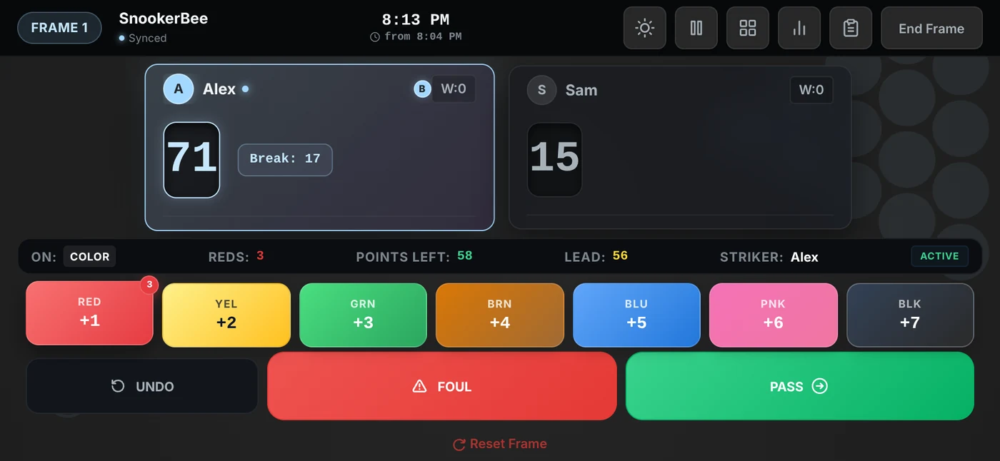
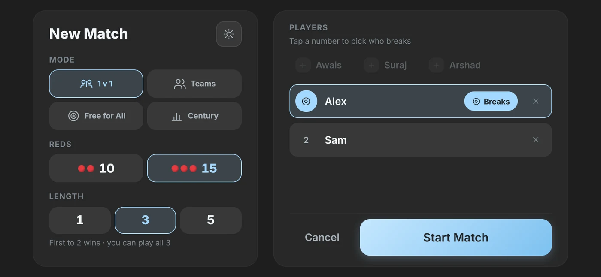
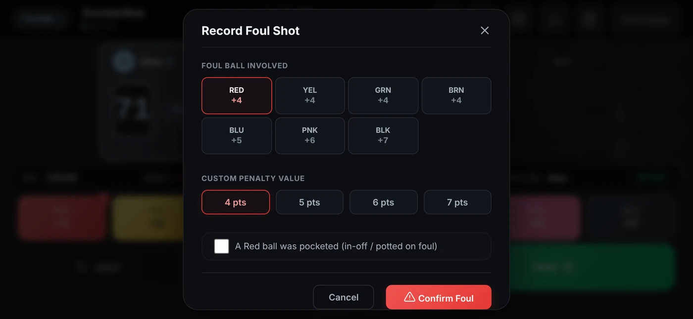
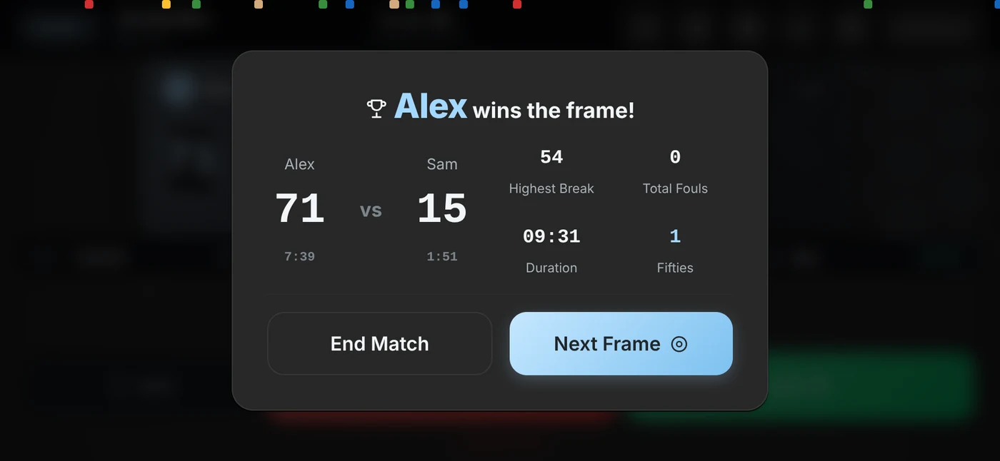
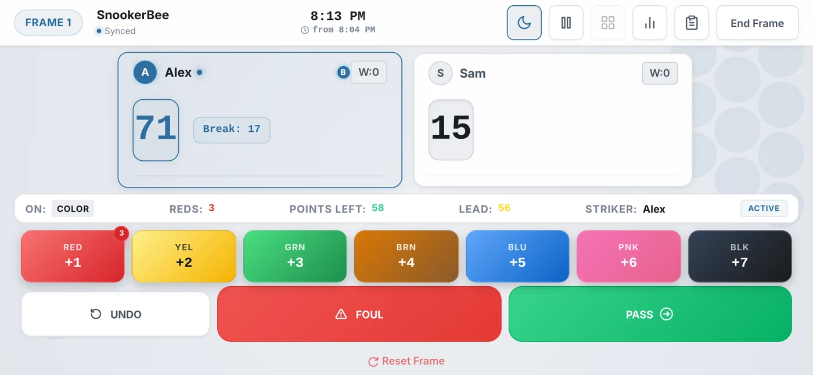

<div align="center">

# 🐝 SnookerBee

**A snooker scorer that knows the rules, so you don't have to argue about them.**

[**▶ Open the app**](https://snookerbee.vercel.app) · installs to your home screen · works offline

[](https://github.com/arshad0126/snookerbee/actions/workflows/ci.yml)
[](https://react.dev/)
[](https://www.typescriptlang.org/)
[](https://vite.dev/)
[](https://vite-pwa-org.netlify.app/)
[](https://supabase.com/)
[](https://vitest.dev/)
[](https://snookerbee.vercel.app)

<br>



</div>

---

Keeping score on paper works right up until someone pots a red on a foul, or the black gets re-spotted, or nobody can remember whose visit it is. SnookerBee is a phone-sized referee: it enforces the sequence, computes the penalties, and stays out of the way the rest of the time.

It runs offline, installs to your home screen, and survives iOS deciding to close it mid-frame.

> **Built for landscape.** The scoring layout needs the width, so portrait shows a rotate prompt rather than a squeezed table.

## At a glance

<table>
  <tr>
    <td width="50%"></td>
    <td width="50%"></td>
  </tr>
  <tr>
    <td align="center"><sub><b>One-screen setup</b> — mode, reds, length and who breaks</sub></td>
    <td align="center"><sub><b>Fouls</b> — penalty worked out from the ball, with a manual override</sub></td>
  </tr>
  <tr>
    <td width="50%"></td>
    <td width="50%"></td>
  </tr>
  <tr>
    <td align="center"><sub><b>Frame summary</b> — highest break, time at the table, milestones</sub></td>
    <td align="center"><sub><b>Light and dark themes</b>, switchable mid-match</sub></td>
  </tr>
</table>

---

## What it does

### 🎱 The rules engine

A pure reducer — no side effects, fully testable — that holds the frame together:

- **Red → colour alternation**, then the colours in ascending order once the reds are gone
- **Free ball nomination**, scoring at the value of the ball it stands for
- **Re-spotted black** when the frame ends level
- **Foul penalties** computed from the ball involved, with a manual override for the cases the table can't see
- **Turn rotation** across 1v1, teams and free-for-all
- **10-step undo, with Redo** — whole states are snapshotted, and because the reducer never mutates, a shallow copy is a stable one

### 🏆 Match formats

| Mode | |
| --- | --- |
| **1 v 1** | Standard head-to-head |
| **Teams** | 2v2 or 3v3, alternating visits |
| **Free-for-All** | 2–8 players, solo scoring |
| **Century** | Race to exactly 50 or 100 |

10 or 15 reds. Best of 1, 3 or 5 — odd only, so a match can't end level.

Each frame rotates who breaks, and the rest follow in the order you set: `1,2,3` → `2,1,3` → `3,1,2`. Everyone plays after someone different.

### ⏱️ While you're playing

- **Century and half-century tracking** — counted when a break *ends*, at its highest tier, so a 104 is one century rather than a century and a fifty
- **Break milestone chimes** at 50 and 100, fired on crossing the threshold rather than landing exactly on it
- **Web Audio sound effects** — pots, fouls, milestones and fanfares synthesised from oscillators, so they work offline with no audio files
- **A wall clock** showing the time and when the frame began
- **Pause, and previous frames at a glance**

### 📊 Afterwards

- **Share cards** — the match or a single frame rendered to a PNG and handed to the native share sheet
- **Every match gets its own page** — per-player scores, frames, highest break, fouls and time, plus a frame-by-frame breakdown
- **Player stats** — form, breaks, head-to-head, what you pot, fouls by ball, when you play
- **Played together** — pick two or three players and see stats from only the games where exactly that group played
- **History**, stored locally as a guest or synced to Supabase when signed in, with export and backup

---

## Notes on how it's built

A few decisions that aren't obvious from the outside:

**Durations are subtracted, not counted.** There's no ticking timer. Start times are recorded and elapsed time is derived from them, so backgrounding the app can't lose time, undo can't rewind the clock, and nothing re-renders once a second for the length of a match.

**Matches survive the app dying.** iOS terminates backgrounded web apps. State is written to `localStorage` as you play, so the dashboard can offer to resume, and a finished match is held until a save actually succeeds.

**Sharing is preview-first.** iOS drops user activation across an `await`, so generating a PNG and *then* calling `navigator.share()` silently fails. The card is shown first; the share button is a fresh gesture with the file already in hand.

**A version can't ship without release notes.** `npm run build` runs [`scripts/check-release.mjs`](scripts/check-release.mjs) first. It fails the build — and so the Vercel deploy — unless `package.json` matches the newest entry in [`src/changelog.ts`](src/changelog.ts), versions run newest → oldest, and every entry is dated and lists a change. The app reads the same file for its *What's new* page.

**Colour lives on the content, not behind it.** Selected states tint text and icons rather than filling the element, which keeps one thing loud per screen instead of five.

---

## Tech

| Layer | Choice |
| --- | --- |
| UI | React 19, TypeScript, Vite 8 |
| Routing | React Router 7 |
| State | `useReducer` state machine, no external store |
| Styling | Vanilla CSS with design tokens, themed by class |
| Offline | `vite-plugin-pwa` + Workbox |
| Audio | Web Audio API oscillators |
| Backend | Supabase (Postgres + Google OAuth, Row Level Security) |
| Testing | Vitest — rules engine, results, frame analysis, player stats |
| Lint | oxlint |
| CI | GitHub Actions — lint, test and build on every push and PR |
| Hosting | Vercel, gated by a release-notes check |

---

## Running it locally

Requires Node 18+.

```bash
git clone https://github.com/arshad0126/snookerbee.git
cd snookerbee
npm install
npm run dev
```

Then open the printed URL — usually `http://localhost:5173` — and turn your phone (or the browser window) sideways.

| Script | |
| --- | --- |
| `npm run dev` | Dev server with HMR |
| `npm test` | Vitest suite |
| `npm run lint` | oxlint |
| `npm run build` | Release-notes check, typecheck and production build |
| `npm run preview` | Serve the built output |

Cloud sync is optional. Without Supabase credentials the app runs in guest mode and keeps history on the device.

---

## Configuration

Set these in `.env` locally, or in your host's environment settings:

```env
VITE_SUPABASE_URL=your_supabase_project_url
VITE_SUPABASE_ANON_KEY=your_supabase_anon_public_key
```

Vite inlines these at **build** time, so a deployment missing them produces a bundle that can't reach the database — rebuild after changing them.

---

## Database schema

Create a Supabase project, open the **SQL Editor**, and run [`docs/schema.sql`](docs/schema.sql).

It is additive and safe to run against a database that already holds matches. If you set the project up before Century mode existed, running it again adds the two new tables and the milestone columns without touching anything else.

Row Level Security is on for every table — a signed-in user can only reach their own rows.

<details>
<summary><b>The original three tables, for reference</b></summary>

```sql
-- Matches
create table matches (
  id uuid primary key default gen_random_uuid(),
  user_id uuid references auth.users(id) on delete cascade,
  mode text not null,
  reds_count int not null,
  best_of int not null,
  created_at timestamptz default now(),
  duration_ms bigint not null,
  winner_name text not null
);

alter table matches enable row level security;
create policy "Users can CRUD their own matches" on matches
  for all using (auth.uid() = user_id);

-- Players within a match
create table match_players (
  id uuid primary key default gen_random_uuid(),
  match_id uuid references matches(id) on delete cascade,
  player_name text not null,
  team_name text,
  total_score int default 0,
  highest_break int default 0,
  frames_won int default 0,
  fouls_committed int default 0,
  time_spent_ms bigint default 0
);

alter table match_players enable row level security;
create policy "Users can CRUD their own match players" on match_players
  for all using (
    match_id in (select id from matches where user_id = auth.uid())
  );

-- Frame-by-frame action logs
create table match_frames (
  id uuid primary key default gen_random_uuid(),
  match_id uuid references matches(id) on delete cascade,
  frame_number int not null,
  duration_ms bigint,
  action_log jsonb
);

alter table match_frames enable row level security;
create policy "Users can CRUD their own match frames" on match_frames
  for all using (
    match_id in (select id from matches where user_id = auth.uid())
  );
```

</details>

---

## Project layout

```
src/
├── engine/        Rules engine — reducer, validators, types, constants (+ tests)
├── components/    Screens, plus ui/ for the shared component library
├── lib/           Supabase, local storage, audio, share cards (+ tests)
├── hooks/         Auth and theme
├── styles/        Design tokens and stylesheets
└── changelog.ts   Release notes — the build checks it, the app shows it
```

The engine has no React in it. `reducer.ts` takes a state and an action and returns a state, which is why the rules can be reasoned about — and corrected — without touching the interface.

---

<div align="center">

**Built for the table, not the spreadsheet.**

[Open SnookerBee →](https://snookerbee.vercel.app)

</div>
